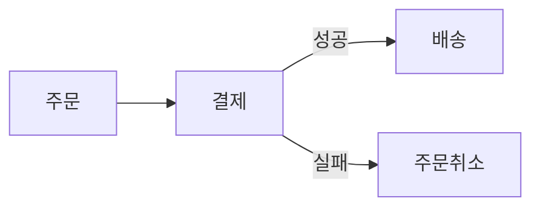
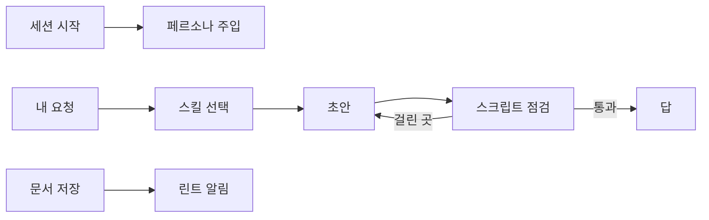

<p align="center"></p>

<p align="center"><b>저는 원숭이예요. 어려운 말은 못 알아듣고 AI 말투는 금방 알아채요.</b></p>

<p align="center">im-a-monkey는 Claude가 쓰는 한국어를 이런 원숭이도 끝까지 읽을 수 있게 고치는 Claude Code 플러그인이에요.<br>글을 짧게 줄이는 대신 읽는 순서와 문장을 손봐요.</p>

<p align="center">
  
  
  
  
  
</p>

<p align="center">
  <a href="#30초-설치">설치</a> ·
  <a href="#이렇게-쓰길-권해요">사용법</a> ·
  <a href="#추천-흐름">추천 흐름</a> ·
  <a href="#이런-글을-고쳐요">예시</a> ·
  <a href="#스킬-7개">스킬</a> ·
  <a href="#어떻게-움직이나요">작동 방식</a> ·
  <a href="#자주-묻는-것">FAQ</a>
</p>

## 30초 설치

```
/plugin marketplace add polyglot-k/im-a-monkey
/plugin install im-a-monkey@im-a-monkey
```

새 세션부터 페르소나가 켜져요. Claude가 결론을 먼저 말하고 원인과 결과처럼 붙어 다니는 사실은 한 문장으로 이어 말해요. 문서를 부탁받으면 목적에 맞는 구조부터 잡아요.

## 이렇게 쓰길 권해요

스킬 이름은 외울 필요 없어요. 평소처럼 말하면 요청에 맞는 스킬이 골라지거든요.

| 상황 | 이렇게 말해요 | 일어나는 일 |
|---|---|---|
| 평소 대화 | 그냥 물어봐요 | 페르소나가 늘 켜져 있어요. 결론 먼저, 쉬운 말 먼저 |
| 설명이 어려울 때 | "이게 무슨 말이야", "쉽게 설명해" | `monkey-clear`가 압축된 설명을 단계별로 풀어요 |
| 남에게 줄 문서 | "팀 리드가 승인할 문서로 써줘: …" | `monkey-doc`이 구조를 고른 뒤 그림 자리를 잡고 마지막에 윤문과 점검까지 해요 |
| 다 쓴 글 점검 | "AI 같아?" → "문장 다듬어줘" | `monkey-human`이 먼저 점수와 고칠 곳만 보여 주고 그다음에 고쳐요 |
| 흐름이나 비교 | "이 흐름 그림으로 그려줘" | `monkey-visual`이 그림을 고르고 질문 캡션을 달아요 |
| 같은 지적이 또 나올 때 | "다음엔 이러지 마, 규칙으로 남겨" | `monkey-learn`이 내 로컬 규칙에 한 줄 더해요 |

결과를 더 잘 맞추는 습관 세 가지:

- 문서를 부탁할 때 독자와 할 일을 한 줄 붙여요. "누가 읽고 읽은 뒤 무엇을 하는지"가 있으면 Claude가 묻지 않고 바로 구조를 정해요. 없을 때만 한 번 묻죠.
- 남의 글은 바로 고치게 하기 전에 "AI 같아?"로 어디가 걸리는지부터 봐요. 잘 쓴 글이면 "고칠 곳 없음"으로 끝나서 멀쩡한 문장을 건드릴 일이 없어요.
- 마음에 안 드는 곳은 "너무 짧아", "용어가 어려워"처럼 그 자리에서 짚어요. 같은 지적이 반복될 때 규칙으로 남겨 두면 쓸수록 결과가 내 취향에 가까워져요.

## 추천 흐름

스킬은 하나씩 불러도 되지만 이어서 쓸 때 손이 덜 가요. 권하는 순서는 아래 세 가지.

### 문서 쓰기

요청에 독자와 할 일을 한 줄 붙이면 `monkey-doc`이 의도와 구조를 정한 다음 그림 자리는 `monkey-visual`에, 문장은 `monkey-human`의 `fix` 모드에 넘기고 `lint.py`와 `visual.py`가 0건이 될 때까지 고쳐요. 파일로 저장할 때 훅이 린트 결과를 한 번 더 알려 주지만 막지는 않아요. 결과가 마음에 안 들면 그 자리에서 짚으면 되고 같은 지적이 또 나오면 `monkey-learn`으로 규칙을 남겨요.


그림 1. 문서 한 편은 어떤 순서로 만들어지나요? `monkey-doc`이 구조를 정한 뒤 그림과 윤문을 차례로 부르고 스크립트 점검이 0건이 될 때까지 돌려요. 사람이 할 일은 처음의 한 줄과 마지막의 지적뿐이죠.

### 남의 글 다듬기

"AI 같아?"라고 물으면 `monkey-human`이 `scan` 모드로 글은 그대로 둔 채 수치와 고칠 곳 표본 3곳만 보여 줘요. 고칠 만하다 싶을 때 "문장 다듬어줘"라고 하면 `fix` 모드가 진단에 걸린 문장만 고치고 숫자·부정어·링크가 원문과 같은지 `preserve.py`로 대조한 결과까지 같이 보고해요. 직접 맞춰 볼 때는 `python3 scripts/preserve.py old.md new.md`.

### 팀 저장소와 CI

문서 폴더에 스크립트 점검을 걸어 두면 사람이 쓴 문서도 같은 기준으로 걸러져요.

```bash
python3 scripts/lint.py docs && python3 scripts/visual.py docs
```

`rhythm.py`는 파일을 하나씩 받고 늘 0으로 끝나서 CI를 막지 않아요. 리듬 경고는 파일마다 따로 돌려서 봐요.

## 이런 글을 고쳐요

### 번역투와 AI 상투어 (`monkey-human`)

뜻과 말투, 확신의 정도는 그대로.

<!-- monkey-lint: off -->
```text
전: 해당 기능은 사용자들에게 있어 매우 중요한 역할을 수행하고 있다고 할 수 있습니다.
```
<!-- monkey-lint: on -->

```text
후: 이 기능은 사용자에게 매우 중요한 역할을 합니다.
```

### 식별자로 꽉 찬 압축 설명 (`monkey-clear`)

결론을 맨 앞에, 식별자는 사람 말 다음에 둬요.

<!-- monkey-lint: off -->
```text
전: retry_max=0이라 sync_job 실패 시 재시도 X → 큐 적체, 아침 리포트 지연.
```
<!-- monkey-lint: on -->

```text
후: 아침 리포트가 늦어진 건 재시도가 꺼져 있어서예요.
    작업 하나가 한 번 실패하면 다시 돌지 않고(sync_job, retry_max=0) 그 사이 큐에 작업이 쌓여요.
```

### 캡션 없는 그림 (`monkey-visual`)

그림 바로 아래에 그림이 답하는 질문과 답을 달아요.


그림 2. 결제가 실패하면 주문은 어떻게 되나요? 배송으로 넘어가지 않고 주문이 취소돼요.

### 목적 없는 문서 (`monkey-doc`)

누가 읽고 무엇을 할지부터 정한 다음 거기에 맞는 구조를 골라요.

```text
요청: 지난주 로그인 장애를 팀에 공유할 글을 써 줘.
고른 구조: 유형 report, 200~800 어절, 맨 위에 영향·원인·조치 세 줄 요약
           블록 순서: 결론 → 흐름 그림 → 예시 → 위험 → 요청 → 열린 질문
```

긴 사례 6개는 [examples/](examples/README.md)에 있어요.

## 왜 im-a-monkey인가요

세는 일은 스크립트가 맡아요. 번역투 표지와 분량, 본문 속 파일 경로, 캡션 없는 그림은 정규식과 규칙으로 찾고 모델은 판단이 필요한 곳에만 써요.

없는 내용은 지어 넣지 않아요. 윤문한 뒤에는 숫자, 고유명사, 부정어, 링크가 원문과 같은지 스크립트로 대조해요. 문서에 빈칸이 있으면 지어 채우는 대신 `<채울 값>`으로 남기고 물어요.

결정 요청, ADR, 장애 보고, 런북, 레퍼런스, 메시지, PR 설명, 교보재는 길이와 자세함은 물론 각주와 표를 쓸지까지 유형마다 따로 정해 뒀고 맞는 유형이 없으면 새 구조를 조립해요. "다음엔 이러지 마", "규칙으로 남겨" 같은 지적은 내 로컬 규칙으로 남아 다음 글부터 반영되고요.

## 스킬 7개

어느 스킬이 맞는지 모르겠으면 `monkey`에게 물어보세요.

| 하고 싶은 일 | 스킬 |
|---|---|
| 문장의 AI 티와 번역투를 찾고 고쳐요 | `monkey-human` |
| 개념이나 코드, 장애 원인을 쉽게 풀어요 | `monkey-clear` |
| 흐름이나 구조를 그림과 표로 보여 줘요 | `monkey-visual` |
| 공유할 문서를 쓰거나 구조를 다시 잡아요 | `monkey-doc` |
| 받은 지적을 규칙으로 남겨요 | `monkey-learn` |
| 말투를 바꾸거나 페르소나를 꺼요 | `monkey-voice` |
| 어떤 스킬을 쓸지 안내해요 | `monkey` |

## 어떻게 움직이나요


그림 3. 플러그인은 어디에서 끼어드나요? 세션을 시작할 때와 문서를 저장한 직후에 훅이 돌아요. 그 사이에는 스킬이 초안을 쓴 뒤 스크립트 결과를 보고 다시 고쳐요.

훅은 세 개예요. 세션 시작 때 말투 규칙을 넣고 한국어 요청마다 두 줄짜리 리마인더를 붙이며 `.md`나 `.html`을 저장하면 린트 결과를 알려 줘요. 알리기만 할 뿐 어느 훅도 작업을 막지 않아요.

## 평가해 봤어요

스킬 없이 돌린 답과 스킬을 켠 답을 Claude가 순서를 바꿔 세 번씩 판정했더니 페르소나를 꺼도 사례 8건 모두 스킬 쪽이 이겼어요(판정 24회 중 24회). 헷갈리기 쉬운 요청 18개로 스킬을 고르게 한 결과도 18개 모두 맞았고요. 다만 사례 수가 적고 판정자도 Claude라는 한계가 있죠. 직접 확인하려면 [evals/README.md](evals/README.md)를 따라 돌려 보세요.

## 말투 바꾸기와 끄기

기본 말투는 해요체예요. 대화 중에 "반말로 해"라고 하면 `monkey-voice`가 설정을 `haeyo`, `banmal`, `hapnida`, `off` 네 값 가운데 하나로 바꿔요.

한 세션만 바꿀 때는 환경 변수가 설정 파일보다 먼저 적용돼요.

```
IM_A_MONKEY_VOICE=banmal claude
```

## 내 규칙 두기

설정과 개인 규칙은 한 폴더에 모여요.

```
python3 hooks/config.py path
```

`$XDG_CONFIG_HOME/im-a-monkey/`가 있으면 그곳, 없으면 `~/.config/im-a-monkey/`예요. 안에는 `config.json`(말투)과 `overlay/antipatterns.md`(내가 추가한 안티패턴), `overlay/types/*.md`(내가 추가한 문서 유형)가 들어가는데 플러그인을 업데이트해도 이 폴더는 그대로 남아요.

## 스크립트만 쓰기

플러그인 없이 CI나 에디터에서 스크립트만 써도 돼요. Python 3.9 이상이면 외부 패키지 없이 돌아가요.

| 스크립트 | 하는 일 | 예 |
|---|---|---|
| `lint.py` | 안티패턴을 찾아요 | `python3 scripts/lint.py doc.md --type report` |
| `rhythm.py` | 문장 길이와 어미가 단조로운지 재요 | `python3 scripts/rhythm.py doc.md` |
| `preserve.py` | 고치기 전후로 숫자, 코드, 링크가 그대로인지 봐요 | `python3 scripts/preserve.py old.md new.md` |
| `visual.py` | 그림 캡션과 콜아웃 쓰임을 점검해요 | `python3 scripts/visual.py doc.md` |
| `coderef.py` | 글에 적은 코드 위치가 그 커밋에 실제로 있는지 확인해요 | `python3 scripts/coderef.py doc.md --repo .` |

`--json`을 붙이면 결과가 JSON으로 나와요. `lint.py`와 `visual.py`는 파일이나 폴더를 여럿 받아요.

```bash
python3 scripts/lint.py skills persona catalog README.md && python3 scripts/visual.py skills persona catalog README.md
```

## 자주 묻는 것

| 질문 | 답 |
|---|---|
| 영어 문서에도 써요? | 한국어 글이 기준이에요. 영어 용어가 섞인 한국어는 잘 다루지만 영어로만 된 문서에는 저장 린트도 끼어들지 않아요. |
| 잘 쓴 글을 망가뜨리지 않아요? | 진단에 걸린 문장만 고치고 수정 비율을 같이 알려 줘요. 고칠 곳이 없으면 "고칠 곳 없음"으로 끝나요. |
| Python이 없으면요? | 스킬이 체크리스트만 보고 일해요. 빠지는 건 스크립트 점검뿐이에요. |
| 내 CLAUDE.md의 말투 규칙과 부딪히면요? | 내 규칙이 이겨요. 페르소나에 그렇게 양보하라고 적혀 있어요. |

## 기여

- 안티패턴은 `catalog/antipatterns.md`에 ID를 붙여 적어요. ID는 분류 글자와 두 자리 숫자(`S01`, `A12`)이고 한 번 쓴 ID는 다시 쓰지 않으며 목차에도 올려요.
- 예문은 다른 글에서 가져오지 않고 직접 새로 써요.
- 고친 뒤에는 저장소 루트에서 테스트를 돌려요.

```
python3 -m unittest discover -s tests -v
```

라이선스는 MIT, 전문은 [LICENSE](LICENSE).
