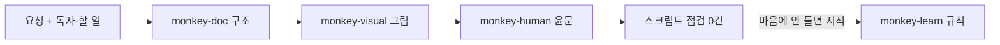

<p align="center"></p>

<p align="center"><b>저는 원숭이예요. 어려운 말은 못 알아듣고 AI 말투는 금방 알아채요.</b></p>

<p align="center">im-a-monkey는 Claude가 쓰는 한국어를 이런 원숭이도 끝까지 읽을 수 있게 고치는 Claude Code 플러그인이에요.<br>글을 짧게 줄이는 대신 읽는 순서와 문장을 손봐요.</p>

<p align="center">
  
  
  
  
  
</p>

## 설치

```
/plugin marketplace add polyglot-k/im-a-monkey
/plugin install im-a-monkey@im-a-monkey
```

새 세션부터 Claude가 결론을 먼저 말하고 문서를 부탁받으면 목적에 맞는 구조부터 잡아요.

## 이런 글을 고쳐요

번역투와 AI 상투어는 걷어 내고 뜻과 말투, 확신의 정도는 그대로 둬요.

<!-- monkey-lint: off -->
```text
전: 해당 기능은 사용자들에게 있어 매우 중요한 역할을 수행하고 있다고 할 수 있습니다.
```
<!-- monkey-lint: on -->

```text
후: 이 기능은 사용자에게 매우 중요한 역할을 합니다.
```

식별자로 꽉 찬 설명은 결론부터 풀고 식별자를 사람 말 뒤로 보내요.

<!-- monkey-lint: off -->
```text
전: retry_max=0이라 sync_job 실패 시 재시도 X → 큐 적체, 아침 리포트 지연.
```
<!-- monkey-lint: on -->

```text
후: 아침 리포트가 늦어진 건 재시도가 꺼져 있어서예요.
    작업 하나가 한 번 실패하면 다시 돌지 않고(sync_job, retry_max=0) 그 사이 큐에 작업이 쌓여요.
```

그림 캡션, 문서 구조, 런북처럼 긴 사례는 [examples/](examples/README.md)에 있어요.

## 쓰는 법

스킬 이름을 외울 필요는 없어요. 평소처럼 말하면 아래 표처럼 요청에 맞는 스킬이 골라지고 문서 요청이면 여러 스킬이 순서대로 이어서 움직이거든요.

| 이렇게 말하면 | 이 스킬이 움직여요 |
|---|---|
| "이게 무슨 말이야", "쉽게 설명해" | `monkey-clear`가 압축된 설명을 단계별로 풀어요 |
| "팀 리드가 승인할 문서로 써줘: …" | `monkey-doc`이 구조를 고르고 그림과 윤문, 점검까지 이어서 해요 |
| "AI 같아?" → "문장 다듬어줘" | `monkey-human`이 먼저 고칠 곳만 보여 주고 그다음에 고쳐요 |
| "이 흐름 그림으로 그려줘" | `monkey-visual`이 그림을 고르고 질문 캡션을 달아요 |
| "다음엔 이러지 마, 규칙으로 남겨" | `monkey-learn`이 내 로컬 규칙에 한 줄 더해요 |
| "반말로 해", "페르소나 꺼" | `monkey-voice`가 말투를 바꾸거나 꺼요 |
| "어떤 monkey 스킬을 써야 해?" | `monkey`가 맞는 스킬을 알려 줘요 |

문서를 부탁할 때는 누가 읽고 읽은 뒤 무엇을 하는지 한 줄을 붙여 주세요. 그게 있으면 묻지 않고 바로 구조를 정하고 없을 때만 한 번 물어요.


그림 1. 문서 한 편은 어떤 순서로 만들어지나요? 구조를 정한 뒤 그림과 윤문을 차례로 거치고 스크립트 점검이 0건이 될 때까지 고쳐요. 사람이 할 일은 처음의 한 줄과 마지막의 지적 정도예요.

남이 쓴 글이라면 바로 고치게 하기보다 "AI 같아?"로 어디가 걸리는지부터 보는 편이 안전한데 잘 쓴 글이면 "고칠 곳 없음"으로 끝나서 멀쩡한 문장을 건드리지 않기 때문이에요.

## 설정

기본 말투는 해요체예요. `haeyo`, `banmal`, `hapnida`, `off` 중에서 고를 수 있고 한 세션만 바꿀 때는 `IM_A_MONKEY_VOICE=banmal claude`처럼 환경 변수를 쓰면 돼요. 내가 남긴 규칙과 말투 설정은 `~/.config/im-a-monkey/`에 모여서 플러그인을 업데이트해도 그대로 남아요.

## 더 보기

- [자세한 사용법](docs/guide.md): 훅이 끼어드는 지점, 스크립트만 따로 쓰기, CI에 붙이기, 평가 결과, 자주 묻는 것
- [examples/](examples/README.md): 스킬별 전후 사례 6개
- [evals/README.md](evals/README.md): 스킬이 기준선보다 나은지 직접 돌려 보는 법
- [CONTRIBUTING.md](CONTRIBUTING.md): 안티패턴 추가 규칙과 테스트

MIT 라이선스예요.
