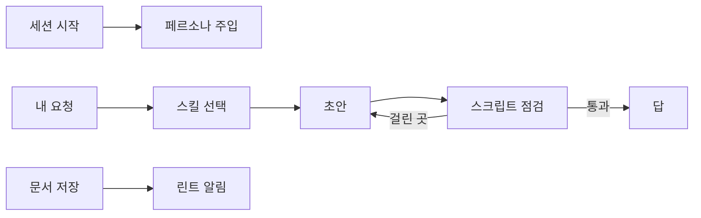
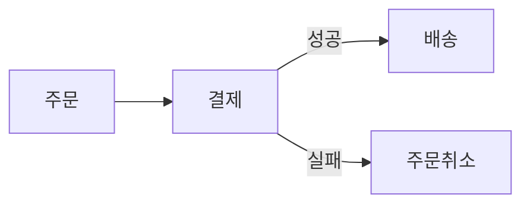

# 자세한 사용법

README에서 뺀 세부 내용을 모아 둔 문서라서 스크립트를 따로 쓰거나 팀 저장소에 붙일 때 찾아보면 돼요.

## 어떻게 움직이나요


그림 1. 플러그인은 어디에서 끼어드나요? 세션을 시작할 때와 문서를 저장한 직후에 훅이 돌아요. 그 사이에는 스킬이 초안을 쓴 뒤 스크립트 결과를 보고 다시 고쳐요.

훅은 세 개로, 세션 시작 때 말투 규칙을 넣고 한국어 요청마다 두 줄짜리 리마인더를 붙이며 `.md`나 `.html`을 저장하면 린트 결과를 알려 주는데 알리기만 할 뿐 어느 훅도 작업을 막지 않아요.

## 내 규칙 두기

설정과 개인 규칙은 한 폴더에 모여요.

```
python3 hooks/config.py path
```

`$XDG_CONFIG_HOME/im-a-monkey/`가 있으면 그곳, 없으면 `~/.config/im-a-monkey/`예요. 안에는 `config.json`(말투)과 `overlay/antipatterns.md`(내가 추가한 안티패턴), `overlay/types/*.md`(내가 추가한 문서 유형)가 들어가는데 플러그인을 업데이트해도 이 폴더는 그대로 남아요.

## 스크립트만 쓰기

플러그인 없이 CI나 에디터에서 스크립트만 써도 되고 Python 3.9 이상이면 외부 패키지 없이 돌아가요.

| 스크립트 | 하는 일 | 예 |
|---|---|---|
| `lint.py` | 안티패턴을 찾아요 | `python3 scripts/lint.py doc.md --type report` |
| `rhythm.py` | 문장 길이와 어미가 단조로운지 재요 | `python3 scripts/rhythm.py doc.md` |
| `preserve.py` | 고치기 전후로 숫자, 코드, 링크가 그대로인지 봐요 | `python3 scripts/preserve.py old.md new.md` |
| `visual.py` | 그림 캡션과 콜아웃 쓰임을 점검해요 | `python3 scripts/visual.py doc.md` |
| `coderef.py` | 글에 적은 코드 위치가 그 커밋에 실제로 있는지 확인해요 | `python3 scripts/coderef.py doc.md --repo .` |

`--json`을 붙이면 결과가 JSON으로 나와요. `lint.py`와 `visual.py`는 파일이나 폴더를 여럿 받아요.

```bash
python3 scripts/lint.py skills persona catalog README.md && python3 scripts/visual.py skills persona catalog README.md
```

## 팀 저장소와 CI

문서 폴더에 스크립트 점검을 걸어 두면 사람이 쓴 문서도 같은 기준으로 걸러져요.

```bash
python3 scripts/lint.py docs && python3 scripts/visual.py docs
```

`rhythm.py`는 파일을 하나씩 받고 늘 0으로 끝나서 CI를 막지 않아요. 리듬 경고는 파일마다 따로 돌려서 봐요.

## 평가해 봤어요

스킬 없이 돌린 답과 스킬을 켠 답을 Claude가 순서를 바꿔 세 번씩 판정했더니 페르소나를 꺼도 사례 8건 모두 스킬 쪽이 이겼어요(판정 24회 중 24회). 헷갈리기 쉬운 요청 18개로 스킬을 고르게 한 결과도 18개 모두 맞았고요. 다만 사례 수가 적고 판정자도 Claude라는 한계가 있으니 직접 확인하려면 [evals/README.md](../evals/README.md)를 따라 돌려 보세요.

## 자주 묻는 것

| 질문 | 답 |
|---|---|
| 영어 문서에도 써요? | 한국어 글이 기준이에요. 영어 용어가 섞인 한국어는 잘 다루지만 영어로만 된 문서에는 저장 린트도 끼어들지 않아요. |
| 잘 쓴 글을 망가뜨리지 않아요? | 진단에 걸린 문장만 고치고 수정 비율을 같이 알려 줘요. 고칠 곳이 없으면 "고칠 곳 없음"으로 끝나요. |
| Python이 없으면요? | 스킬이 체크리스트만 보고 일해요. 빠지는 건 스크립트 점검뿐이에요. |
| 내 CLAUDE.md의 말투 규칙과 부딪히면요? | 내 규칙이 이겨요. 페르소나에 그렇게 양보하라고 적혀 있어요. |

## 더 많은 전후 예시

### 캡션 없는 그림 (`monkey-visual`)

그림 바로 아래에 그림이 답하는 질문과 답을 달아요.


그림 2. 결제가 실패하면 주문은 어떻게 되나요? 배송으로 넘어가지 않고 주문이 취소돼요.

### 목적 없는 문서 (`monkey-doc`)

누가 읽고 무엇을 할지부터 정한 다음 거기에 맞는 구조를 골라요.

```text
요청: 지난주 로그인 장애를 팀에 공유할 글을 써 줘.
고른 구조: 유형 report, 200~800 어절, 맨 위에 영향·원인·조치 세 줄 요약
           블록 순서: 결론 → 흐름 그림 → 예시 → 위험 → 요청 → 열린 질문
```

긴 사례 6개는 [examples/](../examples/README.md)에 있어요.

