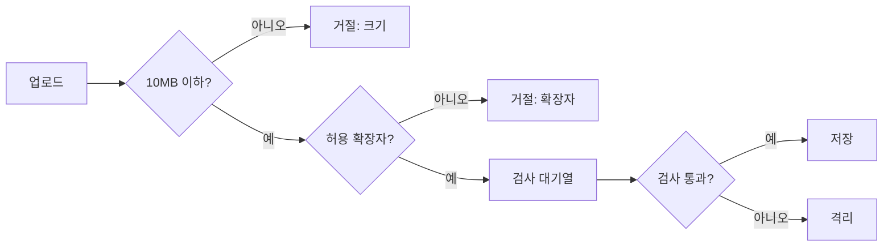

# monkey-visual 예시: 갈래가 있는 흐름

요청: "파일 업로드가 어디서 거절되는지 그림으로 보여 줘."

## 전

<!-- monkey-lint: off -->
업로드된 파일은 먼저 크기를 확인해요. 10MB를 넘으면 거절하고 업로드가 끝나요. 10MB 이하면 확장자를 확인해요. 허용 목록에 없는 확장자도 거절해요. 허용 목록에 있으면 검사 대기열에 넣어요. 검사가 통과하면 저장하고, 통과하지 못하면 격리해요. 거절된 파일은 사용자에게 사유가 보여요. 격리된 파일은 사용자에게 보이지 않아요.
<!-- monkey-lint: on -->

## 후

업로드한 파일이 어느 단계에서 어떻게 끝나는지 아래 그림으로 봐요.

그림 1. 업로드한 파일은 어디서 멈추나? 크기와 확장자에서 걸리면 거절되고 검사에서 걸리면 격리돼요. 나머지는 저장돼요.

그림이 못 보여 주는 것만 적어요. 거절된 파일은 사유가 사용자에게 보이지만 격리된 파일은 사용자에게 보이지 않아요. 그래서 검사에서 걸린 파일은 사용자가 이유를 알 수 없어요.

## 무엇을 바꿨나

<!-- monkey-lint: off -->
- 질문 하나(어디서 멈추나)에 그림 하나예요. 갈래마다 끝(거절, 저장, 격리)을 그렸어요.
- 캡션은 그림 바로 다음 줄에서 `그림 1.`로 시작하고 첫 문장이 물음표로 끝나요.
- 본문은 노드를 다시 읽어 주지 않고, 그림에 없는 사실(사용자에게 보이는지)만 남겼어요.
- 노드 이름은 원문 말을 그대로 썼어요. 없던 단계를 지어 넣지 않았어요.
<!-- monkey-lint: on -->
