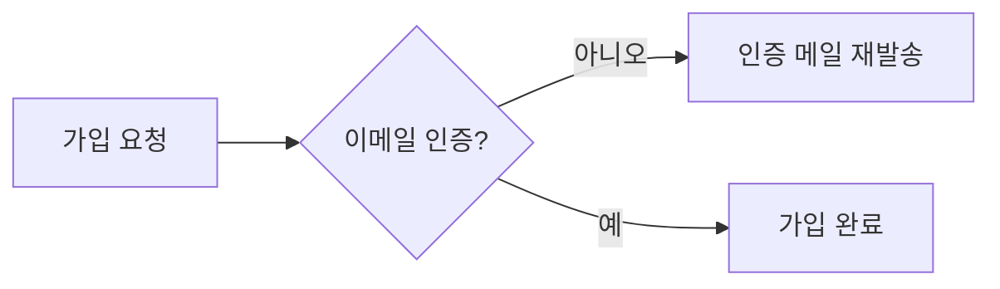

# monkey-visual

## 먼저 지킬 규칙

1. 그림 하나는 독자의 질문 하나에 답해요. 질문을 한 문장으로 못 쓰면 그리지 않아요.
2. 그림 바로 다음 줄에 캡션을 둬요. `그림 N.`으로 시작하고, 첫 문장은 그 질문(물음표로 끝남)이에요. 이어서 답을 한두 문장 붙여요.
3. 본문은 그림을 다시 서술하지 않아요. 같은 내용을 그림과 표로 두 번 그리지도 않아요. 본문에는 그림이 못 보여 주는 것(이유, 사용자가 보는 문구, 미확인 값)만 써요.
4. 비교 그림은 바뀐 것에만 강조를 써요. 색만으로 구분하지 않고 `+`(추가), `−`(제거·위험), `~`(변경) 기호나 글자를 함께 써요.
5. 원문에 없는 수치, 효과, 이유를 그림이나 캡션에 넣지 않아요.

## 그릴지 먼저 정해요

- 문장 두세 개나 번호 목록으로 답이 되면 그리지 않아요. 채팅의 간단한 순서는 번호 목록이에요.
- 독자가 그 자리에서 무엇을 묻는지 한 문장으로 써요. 예: "결제 실패는 어디서 사용자에게 보이나?"
- 아래 표에서 질문에 맞는 요소를 골라요. 질문이 둘이면 그림도 둘이에요.

| 독자의 질문 | 요소 | 마커 종류 |
|---|---|---|
| 누가 무엇을 어떤 순서로? | 시퀀스 다이어그램 | `sequence` |
| 어떤 상태가 어떻게 바뀌나? | 상태 다이어그램 | `state` |
| 어디서 갈라지나? | 흐름도 | `flow` |
| 무엇이 무엇 위에 있나? | 계층·구조 그림 | `layer` |
| 전후·A/B가 어떻게 다른가? | 비교 표 또는 나란히 놓은 그림. 차이에만 강조 | `compare` |
| 실제 값으로 보면? | 숫자 예시 표 | `example` |
| 언제 무슨 일이? | 타임라인 | `timeline` |
| 주의할 점은? | 콜아웃 | `callout` |
| 얼마나·추세는? | 차트 | `chart` |

## 초안 마커

문서 초안을 쓸 때는 그림을 그리기 전에 자리를 먼저 표시해요. 다른 스킬(`monkey-doc` 같은)도 이 표시로 그림 자리를 넘겨요.

```
<!-- visual: flow | Q: 결제 실패는 어디서 사용자에게 보이나? | 강조: 사용자 알림 지점 -->
```

- 필드는 `visual`(위 표의 마커 종류), `Q`(답할 질문, 필수), `강조`(선택)예요. 구분자는 ` | `예요.
- `compare`에는 `강조`가 반드시 있어야 해요. 무엇이 바뀌었는지 모르면 비교 그림을 그릴 수 없어요.
- 마커는 초안에만 있어요. 내보내기 전에 모든 마커를 실제 요소로 바꿔요. 남은 마커는 실패예요.
- 사용자가 바로 그림을 달라고 했으면 마커를 내보이지 않고 속으로만 정해요.

## 그리는 법

매체마다 문법이 달라요. `<base>/media.md`(이 스킬의 base directory 안)를 읽고 매체 열을 따라요. 매체를 모르면 GitHub 마크다운으로 그리고, 그렇게 정했다고 한 줄 적어요.

- 마크다운·Obsidian은 Mermaid, HTML은 SVG, Notion은 Notion 블록으로 그려요.
- 노드 이름은 원문 말을 그대로 써요. 원문에 없는 단계를 지어 넣지 않아요.
- 갈래가 있으면 갈래마다 끝(멈춤, 완료)을 그려요. 끝이 안 보이는 갈래를 남기지 않아요.
- 그림 하나에 노드가 열두 개를 넘으면 질문을 나눠 그림을 둘로 나눠요.
- 그림 앞에는 독자가 무엇을 볼지 한 문장만 둬요. 그림 뒤에는 캡션이 와요.

<!-- monkey-lint: off -->
고친 예 (캡션이 질문과 답을 함께 담고, 본문은 노드를 다시 읽어 주지 않아요):


*그림 1. 가입은 어디서 멈추나? 이메일 인증을 안 하면 인증 메일만 다시 가고 가입은 끝나지 않아요.*
<!-- monkey-lint: on -->

## 비교 그림

- 바뀐 항목만 칠하고 기호를 붙여요. 그대로인 항목은 무채색, 기호 없음이에요. 볼드도 바뀐 항목에만 써요.
- 색은 의미가 고정이에요: 추가 초록, 제거·위험 빨강, 변경 노랑, 나머지 무채색.
- 표로 비교할 때는 "변화" 열을 두고 `+`, `−`, `~`를 써요. 바뀌지 않은 행은 그 칸을 비워요.
- 항목이 많은데 바뀐 게 적으면, 바뀐 행을 위로 올리고 그대로인 항목은 한 줄로 묶어도 돼요.
- 계산으로 나오는 값(합계, 마지막 시각)을 보태려면 원문 값으로 계산이 맞는지 확인하고, 계산했다고 밝혀요.

<!-- monkey-lint: off -->
고친 예:

| 항목 | 전 | 후 | 변화 |
|---|---|---|---|
| 백업 주기 | 하루 1회 | **6시간마다** | `~` |
| 보관 기간 | 7일 | 7일 | |
| 원격 사본 | 없음 | **있음** | `+` |

*그림 2. 백업 정책에서 무엇이 달라졌나? 주기가 짧아지고 원격 사본이 생겼어요. 보관 기간은 그대로예요.*
<!-- monkey-lint: on -->

## 독자 표지

- 콜아웃 5종: 결론 · 주의 · 예시 · 결정 필요 · 참고. 다른 종류를 만들지 않아요.
- 신뢰도 배지 3종: `[측정]` · `[추정]` · `[미확인]`. 값 바로 뒤에 붙여요. 사용자가 "들었다", "재 보지 않았다"고 한 값은 `[미확인]`이에요.
- 콜아웃과 배지를 합쳐 한 섹션(제목 하나 아래)에 두 개까지만 써요. 많아지면 표지가 표지 구실을 못 해요. 넘치면 배지 대신 문장으로 "재 보지 않은 값이에요"라고 써요.
- 매체별 문법은 `media.md`의 표를 따라요.

## 렌더 확인

그림을 넣은 뒤 그림마다 렌더를 직접 봤는지 사용자에게 보고해요. 문서 본문에는 넣지 않아요.

```
그림 1 (flow, Q: 가입은 어디서 멈추나?) — 렌더됨
그림 2 (compare, Q: 백업 정책에서 무엇이 달라졌나?) — 못 봄
```

- 브라우저나 미리보기로 직접 본 것만 "렌더됨"이에요. 문법이 맞아 보인다는 건 "못 봄"이에요.
- "못 봄"이 하나라도 있으면 "그림 N은 렌더를 직접 보지 못했어요. 붙여 넣은 뒤 한 번 봐 주세요"라고 말해요. `media.md`에서 "렌더 확인 필요"인 문법을 썼으면 그것도 밝혀요.

## 검사

완성한 글을 파일로 저장하고(채팅 답이면 시스템 임시 폴더에 만든 파일) 검사해요. 검사용으로 만든 파일은 검사가 끝나면 지워요.

```
python3 <base>/../../scripts/visual.py FILE
```

| ID | 뜻 | 고치는 법 |
|---|---|---|
| V01 | 초안 마커가 남았어요 | 실제 그림으로 바꾸거나 지워요 |
| V02 | 그림 바로 아래에 `그림 N. 질문?` 캡션이 없어요 | 그림 다음 줄에 캡션을 넣어요. 사이에 빈 줄은 괜찮아요 |
| V03 | `compare` 마커에 `강조`가 없어요 | 무엇이 바뀌었는지 `강조:`에 적어요 |
| V04 | 한 섹션에 콜아웃·배지가 세 개 이상이에요 | 두 개만 남기고 나머지는 문장으로 써요 |

- 0건이 될 때까지 고쳐요. 결과 건수를 보고에 한 줄 적어요.
- Python이 없거나 스크립트가 실패하면 멈추지 말고 위 표의 네 가지를 눈으로 하나씩 확인해요. 스크립트 없이 체크리스트로 확인했다고 보고에 적어요.
- 답을 바깥 코드 블록으로 감싸 보여 줄 때도 캡션은 그림 바로 다음 줄이에요.

## 자주 하는 실수

| 실수 | 대신 |
|---|---|
| 그림 아래에 바로 다음 제목이나 표가 와요 | 그림 다음 줄에 `그림 N. 질문?` 캡션을 둬요 |
| 흐름도를 그리고 같은 단계를 표나 목록으로 또 써요 | 하나만 남기고, 본문에는 그림에 없는 것만 써요 |
| 거절 지점을 빨간 채움으로만 표시해요 | 노드 이름에 `−`나 "거절" 같은 글자도 써요 |
| 바뀌지 않은 행에도 체크 표시나 볼드를 붙여요 | 바뀐 행에만 강조해요 |
| 그림 설명에 "이제 안정적이에요" 같은 효과를 지어 넣어요 | 원문에 있는 이유만 써요 |
| 재 보지 않은 값을 그림 안에 확정값처럼 넣어요 | `[미확인]`이나 "재 보지 않음"을 붙여요 |

## 마지막으로 지킬 규칙

- 그림마다 바로 다음 줄에 `그림 N. 질문?` 캡션이 있나요? 질문 하나에 그림 하나인가요?
- 본문이나 표가 그림을 다시 읽어 주고 있지 않나요? 겹치면 하나를 지워요.
- 비교 그림에서 강조가 바뀐 것에만 있고, 색 없이도 기호나 글자로 구분되나요?
- 초안 마커가 남지 않았고, 콜아웃·배지는 섹션마다 두 개 이하인가요? `visual.py`가 0건인가요?
- 렌더를 직접 못 본 그림은 못 봤다고 사용자에게 말했나요?
